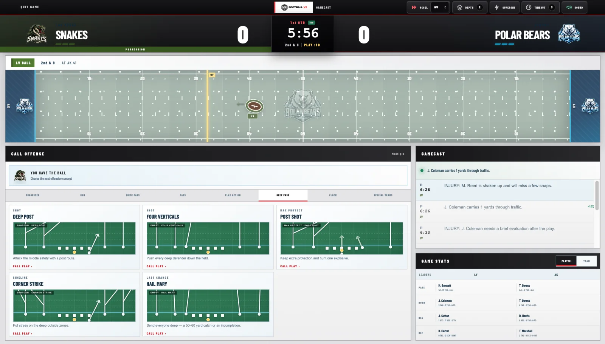

# SAC Football V2

**A browser-first football simulation platform built around the decisions that shape every snap.**

[Launch SAC Football](https://fox-ffl-simulations.pages.dev) · [View Dylan's portfolio](https://dylanfox.work)

## The product

SAC Football V2 lets players call offensive and defensive plays, build custom teams and leagues, and compete through solo games, seasons, or synchronized head-to-head matchups.

## What I built

- A play-by-play simulation experience centered on coaching decisions
- Team, player, and league creation tools
- Persistent seasons, standings, and game results
- Live game-state coordination for online competition
- Operational tools for managing an evolving sports platform

I led the product concept, experience design, gameplay systems, implementation, and release.

## Repository note

This is a public product showcase. The simulation engine, production source code, infrastructure, and internal operating tools are maintained privately.

© 2026 Dylan Fox. All rights reserved.
